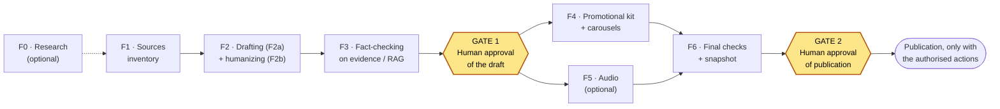

# Editorial Pipeline

[](https://github.com/acarducci65-svg/editorial_pipeline_public/actions/workflows/ci.yml)
[](LICENSE)
[](pyproject.toml)
[](https://github.com/astral-sh/ruff)
[](https://mypy-lang.org/)

**English** · [Italiano](#italiano)

A Python library, CLI and agent skill for the **augmented newsroom**: an editorial team
that works with AI models for drafting, checking and promotion, and keeps every decision
in human hands.

Editorial Pipeline does not write or publish for you. It gives the process structure:
style registers that flag clichés, offline fact-checking against registered evidence,
promotional carousels with integrity manifests, and two **binding human gates** that no
agent can cross on its own.

> **Status: pre-alpha (`0.1.0.dev0`).** The core, the CLI and the local adapters work and are
> tested; remote RAG verification is a non-operational stub and the package is not yet
> published on PyPI. Interfaces may still change.

## Why

AI-assisted writing fails in predictable ways: unsourced numbers, invented anecdotes,
generic prose, and approvals that nobody actually gave. Editorial Pipeline turns each
of these into an explicit, checkable step:

- **Every fact has a source.** Claims are linked to a source key and a precise locator;
  `verify-facts` returns `BLOCK` when the link is missing.
- **Style review is not disguise.** Registers (`academic_essay`, `tech_blog`,
  `investigative`, `cultural_newsletter`) flag clichés to improve readability, not to make
  text "undetectable".
- **No ghost approval.** Only a person can approve the draft (Gate 1) and the publication
  (Gate 2). Agent reviews, IDE notifications or hooks never count.
- **Privacy by design.** Reports contain relative paths only; cloud identifiers live in
  environment variables, never in files.

## Lifecycle: six phases, two human gates



The canonical order is declared in `editorial.toml` (`[phases]`, `gates.gate1.after`,
`gates.gate2.after`). If the text changes after a check, that check and everything that
depends on it must be redone, and an approved gate must be requested again: approvals are
bound to the SHA-256 digest of the exact text the person saw.

## Quickstart

### 1. Install

The package is not on PyPI yet: install it from a clone of the repository.

```sh
# with uv (recommended): the CLI becomes available globally
uv tool install ./editorial_pipeline_public

# or with pip, inside a virtual environment
python -m pip install ./editorial_pipeline_public

# optional extras: carousels (Jinja2 + Playwright) and audio
python -m pip install "./editorial_pipeline_public[social]"
playwright install chromium

editorial-pipeline --help
```

### 2. Try the fictional sandbox

`examples/sample_blog` is an invented blog with fictional author, posts and evidence.
Run the commands from the repository root:

```sh
# overall state: configuration, folders, findings for every post
editorial-pipeline status --config examples/sample_blog/editorial.toml

# style linter + evidence files + digest of the draft
editorial-pipeline validate-draft post_01_valid --config examples/sample_blog/editorial.toml --json

# the second post contains deliberate clichés: the linter returns BLOCK (exit 1)
editorial-pipeline validate-draft post_02_with_cliches --config examples/sample_blog/editorial.toml

# offline fact-check of the registered claims against sources.json
editorial-pipeline verify-facts post_01_valid --config examples/sample_blog/editorial.toml

# carousel export: HTML preview, then PNG/PDF with a SHA-256 manifest
editorial-pipeline build-visual post_01_valid --dry-run --config examples/sample_blog/editorial.toml
editorial-pipeline build-visual post_01_valid --aspect-ratio 4:5 --config examples/sample_blog/editorial.toml
```

### 3. Bind a human approval to the evidence

`check-gate` refuses to run without a token (exit 2). The token is the digest printed by
`validate-draft`; it is passed **only after** the human director has written the
approval phrase in the chat, for that exact digest.

```sh
editorial-pipeline check-gate 1 post_01_valid --config examples/sample_blog/editorial.toml --token <digest>
```

`APPROVED` means the receipt matches the current text. It does not replace the human
decision and is not a proof of identity: see
[`docs/architecture.md`](docs/architecture.md) (section *Gate e sovranità umana*) for
the exact guarantees.

### 4. Start your own newsroom

```sh
editorial-pipeline init my-newsroom
cd my-newsroom
# fill in the {{...}} placeholders in editorial.toml, the author profile and the manifesto
editorial-pipeline status
```

Exit codes: `0` ok · `1` at least one `BLOCK` or an input error · `2` approval refused.

## Documentation

| Document | Content |
| --- | --- |
| [**`docs/manuale_configurazione_e_uso.md`**](docs/manuale_configurazione_e_uso.md) · [**PDF (A4)**](docs/manuale_configurazione_e_uso.pdf) | **Official complete user & configuration manual** (61-page A4 PDF and Markdown, Italian) |
| [`docs/architecture.md`](docs/architecture.md) | Ports & Adapters layout, components, gates and human sovereignty |
| [`docs/configuration.md`](docs/configuration.md) | Full reference of `editorial.toml`, path validation, registers and templates |
| [`docs/rag_factcheck.md`](docs/rag_factcheck.md) | `RagProvider` port, local and NotebookLM adapters, evidence format |
| [`docs/author_guide.md`](docs/author_guide.md) | Guide for the director: what the system does, what it asks, how to approve |
| [`docs/humanizer_guide.md`](docs/humanizer_guide.md) | De-AI-ing checklist and style review evidence |
| [`docs/transparency_pages.md`](docs/transparency_pages.md) | Specs for the `/metodo/`, `/correzioni/`, `/per-chi-scrive/` transparency pages and SSG/CMS integration |
| [`skills/editorial-pipeline/SKILL.md`](skills/editorial-pipeline/SKILL.md) | Operating skill for AI agents: phases, commands, gate protocol |
| [`skills/editorial-pipeline/references/`](skills/editorial-pipeline/references/) | Fact-checking protocol, humanizer checklist, gates and evidence |
| [`examples/sample_blog/`](examples/sample_blog/) | Fictional sandbox used by tests and the quickstart |

The detailed guides are currently written in Italian.

## Multi-agent support

The skill in `skills/editorial-pipeline/` is plain Markdown plus shell commands, so any
agent harness that can read files and run a terminal can use it.

| Agent | How to use it |
| --- | --- |
| **Antigravity IDE** | Load the skill folder into the workspace; run the CLI from the integrated terminal. |
| **Claude Code** | Copy or link `skills/editorial-pipeline/` into `.claude/skills/`; the skill is picked up by its `name` and `description`. |
| **Codex CLI** | Reference `SKILL.md` from `AGENTS.md`; run the CLI through the shell tool. |

Whatever the harness, an agent stops at each gate, asks the configured question and ends
its turn. Tool auto-approval modes concern shell permissions, never editorial gates.

## Contributing

Bug reports, ideas and pull requests are welcome. Read [`CONTRIBUTING.md`](CONTRIBUTING.md)
for the `uv` workflow, the checks (pytest, ruff, strict mypy) and Conventional Commits.
Report vulnerabilities privately as described in [`SECURITY.md`](SECURITY.md).

## License

[Apache License 2.0](LICENSE).

---

## Italiano

**[English](#editorial-pipeline)** · Italiano

Libreria Python, CLI e skill per agenti dedicata alla **redazione aumentata**: una
redazione che usa modelli AI per scrivere, verificare e promuovere, e tiene ogni
decisione nelle mani delle persone.

Editorial Pipeline non scrive e non pubblica al posto vostro. Dà struttura al processo:
registri di stile che segnalano i cliché, verifica offline dei fatti sulle evidenze
registrate, caroselli promozionali con manifest di integrità e due **gate umani
vincolanti** che nessun agente può attraversare da solo.

> **Stato: pre-alpha (`0.1.0.dev0`).** Nucleo, CLI e adapter locali funzionano e sono
> testati; la verifica RAG remota è uno stub non operativo e il pacchetto non è ancora
> pubblicato su PyPI. Le interfacce possono cambiare.

### Perché

La scrittura assistita dall'AI sbaglia in modi prevedibili: numeri senza fonte, aneddoti
inventati, prosa generica, approvazioni che nessuno ha davvero dato. Editorial Pipeline
trasforma ciascuno di questi rischi in un passaggio esplicito e verificabile:

- **Ogni fatto ha una fonte.** Ogni claim è collegato a una chiave di fonte e a un locator
  preciso; `verify-facts` restituisce `BLOCK` se il collegamento manca.
- **La revisione di stile non è mascheramento.** I registri segnalano i cliché per
  migliorare la leggibilità, non per rendere il testo «non rilevabile».
- **Nessuna approvazione fantasma.** Solo una persona approva la bozza (Gate 1) e la
  pubblicazione (Gate 2). Revisioni di altri agenti, notifiche dell'IDE o hook non valgono.
- **Privacy dalla progettazione.** I report contengono solo percorsi relativi; gli
  identificativi cloud stanno in variabili d'ambiente, mai nei file.

### Ciclo di vita: sei fasi, due gate umani

| Fase | Contenuto | Esito |
| --- | --- | --- |
| F0 *(opzionale)* | Ricerca bibliografica | Elenco di letture |
| F1 | Inventario delle fonti con hash e locator | `sources.json` |
| F2 | Stesura (F2a) e umanizzazione in un passaggio separato (F2b) | Bozza + prova di revisione |
| F3 | Verifica dei fatti su evidenze / RAG | `factcheck.json`, `verify-facts` senza `BLOCK` |
| **Gate 1** | **Approvazione umana della bozza** | Ricevuta legata al digest |
| F4 | Kit promozionale e caroselli | Testi per canale, manifest SHA-256 |
| F5 *(opzionale)* | Audio | Puntata o sintesi audio |
| F6 | Controlli finali e snapshot | Report senza `BLOCK` |
| **Gate 2** | **Approvazione umana della pubblicazione** | Ricevuta con le azioni autorizzate |

Il diagramma completo è nella [sezione inglese](#lifecycle-six-phases-two-human-gates).
L'ordine canonico è dichiarato in `editorial.toml`. Se il testo cambia dopo un controllo,
quel controllo e ciò che ne dipende vanno rifatti e il gate va richiesto di nuovo:
l'approvazione è legata al digest SHA-256 del testo che la persona ha visto.

### Avvio rapido

```sh
# 1. Installazione da un clone del repository (non ancora su PyPI)
uv tool install ./editorial_pipeline_public
# oppure: python -m pip install ./editorial_pipeline_public
# extra opzionali: "[social]" per i caroselli, "[audio]" per l'audio

# 2. Sandbox fittizia, dalla radice del repository
editorial-pipeline status --config examples/sample_blog/editorial.toml
editorial-pipeline validate-draft post_01_valid --config examples/sample_blog/editorial.toml --json
editorial-pipeline verify-facts post_01_valid --config examples/sample_blog/editorial.toml
editorial-pipeline build-visual post_01_valid --dry-run --config examples/sample_blog/editorial.toml

# 3. Solo DOPO l'approvazione scritta del Direttore in chat, sullo stesso digest
editorial-pipeline check-gate 1 post_01_valid --config examples/sample_blog/editorial.toml --token <digest>

# 4. Nuova redazione
editorial-pipeline init mia-redazione
```

`APPROVED` attesta che la ricevuta corrisponde al testo attuale: non sostituisce la
decisione umana e non prova l'identità di chi approva.

Codici di uscita: `0` ok · `1` almeno un `BLOCK` o errore di input · `2` approvazione
rifiutata.

### Documentazione

- [**Manuale Ufficiale di Configurazione e Uso**](docs/manuale_configurazione_e_uso.md) · [**Edizione PDF A4 (61 pagine)**](docs/manuale_configurazione_e_uso.pdf): guida completa e dettagliata, capitolo per capitolo, con comandi, configurazione, checklist de-aizing e tutorial pratico.
- Le guide tematiche in [`docs/`](docs/) approfondiscono singoli aspetti: architettura, configurazione, verifica dei fatti, guida per il Direttore, umanizzazione e pagine di trasparenza (`/metodo/`, `/correzioni/`, `/per-chi-scrive/`). La skill operativa per agenti è in [`skills/editorial-pipeline/`](skills/editorial-pipeline/SKILL.md). La tabella completa è nella [sezione inglese](#documentation).

### Agenti supportati

La skill funziona con **Antigravity IDE**, **Claude Code** e **Codex CLI**, e con
qualunque ambiente capace di leggere Markdown ed eseguire comandi di shell. In ogni caso
l'agente si ferma ai gate, pone la domanda configurata e chiude il turno: le modalità di
auto-approvazione dei comandi riguardano i permessi degli strumenti, mai i gate editoriali.

### Contribuire e licenza

Leggete [`CONTRIBUTING.md`](CONTRIBUTING.md) per il flusso di lavoro con `uv`, i controlli
e le convenzioni di commit, e [`SECURITY.md`](SECURITY.md) per le segnalazioni di
sicurezza. Licenza [Apache 2.0](LICENSE).
