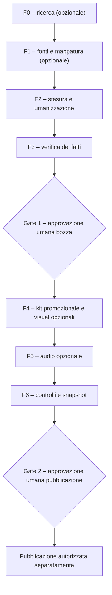

# Architettura e flusso editoriale

Il framework separa modelli, applicazione, configurazione e adapter secondo l'impostazione Ports & Adapters. Le porte permettono di sostituire le integrazioni; la CLI attuale compone direttamente i componenti disponibili. La pipeline descritta sotto è un protocollo di lavoro, non una macchina a stati che esegue o blocca automaticamente tutte le transizioni.

F0–F6 comprendono sei fasi numerate da F1 a F6, con F0 preliminare opzionale; F2 comprende stesura F2a e umanizzazione F2b. I gate sono obblighi del processo: l'operatore deve fermarsi e attendere la decisione umana prima di proseguire.

## Componenti

- **domain**: `Post`, `Finding`, `ChecklistState`, `EvidenceBundle`, `GateDecision` e `VerificationState` (`OK`, `WARN`, `BLOCK`) rappresentano contenuti ed esiti. `HumanApproval` definisce i dati minimi della decisione; `StyleRegister` modella i registri YAML. I modelli di gate e post usano la libreria standard; i registri dipendono da Pydantic e PyYAML.
- **config**: `EditorialConfig` descrive lo schema Pydantic v2; `load_config` legge TOML, `resolve_paths` ancora i percorsi alla radice indicata e `validate_operative` rifiuta segnaposto non espansi. Dettagli in [configuration.md](configuration.md).
- **application**: `StyleChecker` carica il registro e produce finding deterministici per espressioni e pattern, senza riscrivere il testo né approvarlo. Esclude dal controllo parti come codice e URL; `aggregate_state` dà precedenza a `BLOCK`, poi `WARN`.
- **adapters**: `RagProvider` espone `capabilities` e `verify`; il provider locale controlla evidenze registrate, mentre NotebookLM è uno stub non operativo. `VisualBuilder` espone `build_carousel`; `PlaywrightVisualBuilder` genera HTML e, se disponibili, PNG e PDF, con manifest di digest. Vedere [rag_factcheck.md](rag_factcheck.md).
- **cli**: `editorial-pipeline`, implementata con `argparse`, espone `init`, `status`, `validate-draft`, `validate-all`, `verify-facts`, `build-visual` e `check-gate`. `validate-draft` controlla stile e presenza dei file di evidenza; `verify-facts` controlla i claim registrati. I report sono serializzati in JSON con percorsi relativi e sanitizzazione.

## Gate e sovranità umana

Il protocollo vieta la *ghost approval*: solo una persona può decidere Gate 1 e Gate 2. `HumanApproval` rifiuta origine diversa da `human`, autore o token vuoti e timestamp privo di fuso; `GateDecision` accetta solo i numeri 1 e 2 e un'istanza valida. `bind_evidence` confronta il token con il digest fornito tramite `hmac.compare_digest`.

In `check-gate` il digest SHA-256 è calcolato su percorso relativo del post, byte NUL e contenuto; il token deve coincidere. Una modifica del percorso o del contenuto cambia il digest. Il comando stampa una ricevuta JSON, ma non la salva, non usa una firma digitale o un segreto, non autentica l'identità umana e non verifica l'approvazione in chat. Il digest è calcolabile da chiunque: confronto crittografico e integrità non costituiscono prova crittografica di identità o consenso. Inoltre il comando non verifica evidenze, precedente Gate 1, stato delle fasi, azioni autorizzate o artefatti di pubblicazione; l'applicazione non impone automaticamente il blocco delle altre operazioni. Queste verifiche e le due decisioni umane restano responsabilità del processo editoriale.
